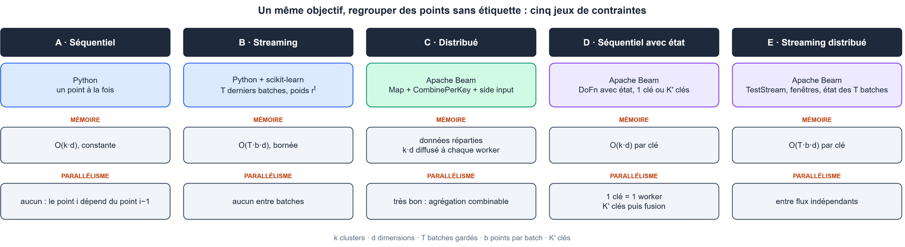
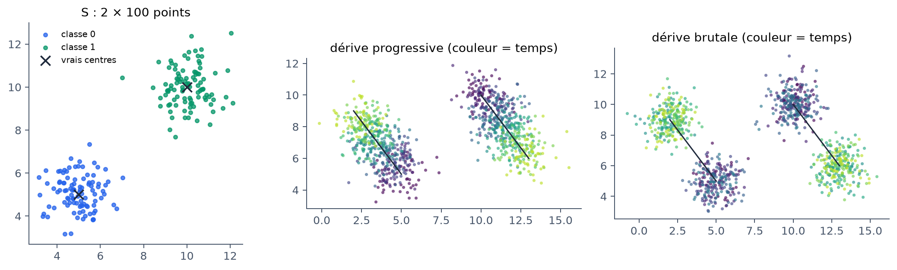
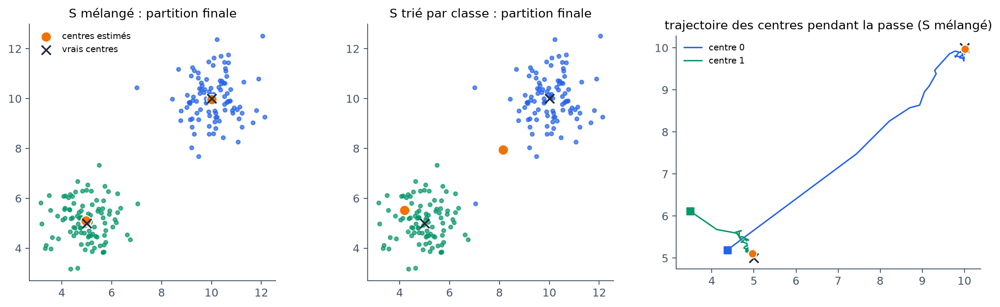
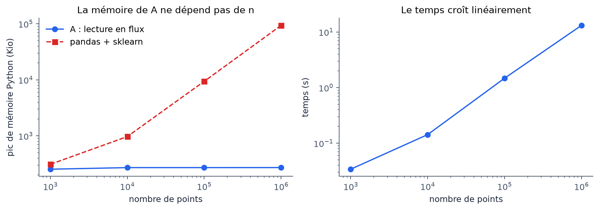
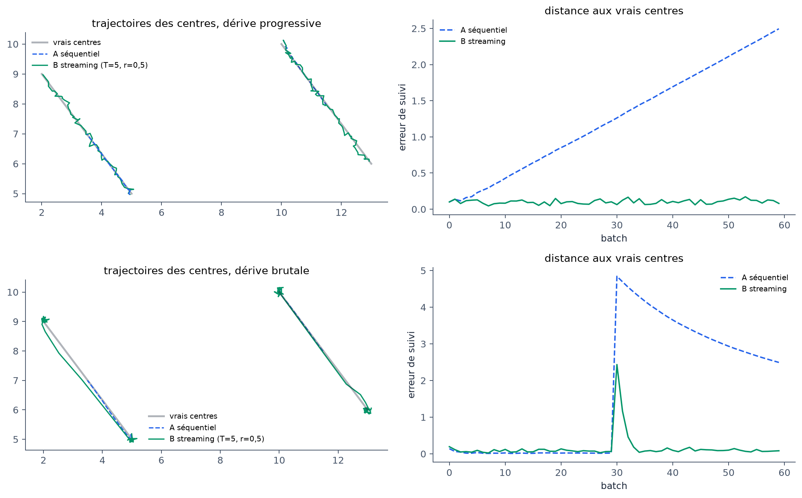
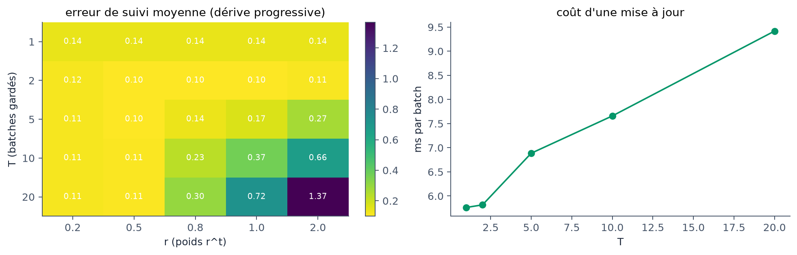
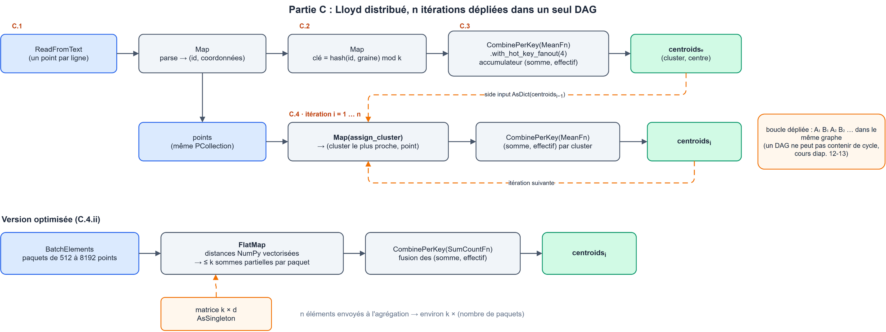
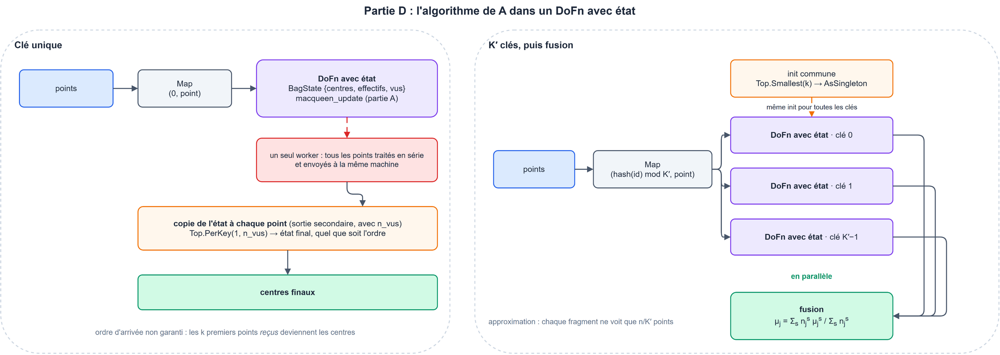
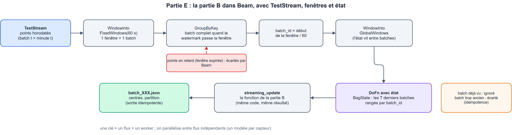

# K-means à grande échelle : cinq implémentations, de Python à Apache Beam

Projet du cours *Big Data* (M2 MLSD, Université Paris Cité, 2026-2027).

Le même objectif, regrouper des points sans étiquette, est atteint ici de cinq façons, chacune sous une contrainte
différente : des données plus grandes que la mémoire (A), une distribution qui change dans le temps (B), un calcul
réparti sur plusieurs machines (C), un état à conserver dans un pipeline distribué (D), puis les deux à la fois (E).
Pour chaque version, j'ai mesuré ce qu'elle garantit, ce qu'elle coûte en mémoire et ce qui limite son parallélisme,
avec des tests qui vérifient que les cinq implémentations concordent.

| | Résultat mesuré |
|---|---|
| A · séquentiel en Python | Pic de mémoire **stable entre 254 et 272 Kio de 10³ à 10⁶ points**, contre 92 Mio en chargeant tout avec pandas |
| B · streaming pondéré | Erreur de suivi d'une dérive progressive : **0,12**, contre 2,30 pour l'algorithme séquentiel |
| C · distribué (Beam) | Mêmes centres que `sklearn.KMeans` depuis la même initialisation, à **4 × 10⁻¹⁵** près ; version optimisée **2,6 fois plus rapide** sur 10⁶ points |
| D · séquentiel avec état (Beam) | Avec une clé unique, **100 % des affectations identiques** à la partie A |
| E · streaming avec état (Beam) | Mêmes centres que B sur les 60 batches (**écart 0**), points en retard écartés par le watermark |

Rendu : [rapport de 5 pages](rendu/Sylla_Nfaly_BigData_rapport.pdf) et [présentation en 18 diapositives](rendu/Sylla_Nfaly_BigData_presentation.pdf).



## Contenu du dépôt

| Chemin | Contenu |
|---|---|
| [`Sylla_Nfaly_BigData_KMeans.ipynb`](Sylla_Nfaly_BigData_KMeans.ipynb) | Le notebook complet, exécuté de bout en bout, avec ses sorties : parties A à E, une cellule de réponse par question de l'énoncé, synthèse |
| `diagrams/` | Un schéma par partie, au format draw.io (modifiable), PNG et PDF |
| `figures/` | Les graphiques produits par le notebook |
| `results/results.json` | Tous les chiffres cités, écrits par le notebook pendant son exécution |
| `rendu/` | Le rapport et la présentation du rendu (PDF) |
| `tools/` | Le générateur du notebook (`build_notebook.py`) et des schémas (`make_diagrams.py`) |
| `requirements.txt` | Les versions utilisées |

Les dossiers `data/` (jusqu'à 10⁶ points, environ 30 Mo) et `outputs/` (sorties des pipelines) ne sont pas versionnés :
le notebook les recrée.

## Lancer le notebook

```bash
uv venv --python 3.11 .venv
uv pip install --python .venv/Scripts/python.exe -r requirements.txt     # Linux/macOS : .venv/bin/python
.venv/Scripts/python.exe -m jupyter nbconvert --to notebook --execute --inplace Sylla_Nfaly_BigData_KMeans.ipynb
```

L'exécution complète prend quelques minutes sur un portable, surtout pour le test d'optimisation de la partie C sur
10⁶ points. Les pipelines Beam tournent avec le runner local (`DirectRunner`). Le même code tournerait sur Dataflow,
Flink ou Spark, mais les temps mesurés ici décrivent une seule machine.

**Versions.** Python 3.11, Apache Beam 2.78, scikit-learn 1.9. pandas doit rester en 2.2 : pandas 3 casse le module
`apache_beam.dataframe` de Beam 2.78.

## Schémas

Les fichiers `.drawio` s'ouvrent et se modifient dans [diagrams.net](https://app.diagrams.net).

| Schéma | Image | Source modifiable |
|---|---|---|
| Les cinq parties : mémoire et parallélisme | [00_overview.png](diagrams/00_overview.png) | [00_overview.drawio](diagrams/00_overview.drawio) ([ouvrir dans diagrams.net](https://app.diagrams.net/#Uhttps%3A%2F%2Fraw.githubusercontent.com%2F8sylla%2Fkmeans-apache-beam%2Fmain%2Fdiagrams%2F00_overview.drawio)) |
| B : fenêtre des T derniers batches pondérés | [01_streaming_window.png](diagrams/01_streaming_window.png) | [01_streaming_window.drawio](diagrams/01_streaming_window.drawio) ([ouvrir dans diagrams.net](https://app.diagrams.net/#Uhttps%3A%2F%2Fraw.githubusercontent.com%2F8sylla%2Fkmeans-apache-beam%2Fmain%2Fdiagrams%2F01_streaming_window.drawio)) |
| C : pipeline distribué, boucle dépliée, version optimisée | [02_beam_distributed.png](diagrams/02_beam_distributed.png) | [02_beam_distributed.drawio](diagrams/02_beam_distributed.drawio) ([ouvrir dans diagrams.net](https://app.diagrams.net/#Uhttps%3A%2F%2Fraw.githubusercontent.com%2F8sylla%2Fkmeans-apache-beam%2Fmain%2Fdiagrams%2F02_beam_distributed.drawio)) |
| D : clé unique ou K′ clés puis fusion | [03_beam_stateful.png](diagrams/03_beam_stateful.png) | [03_beam_stateful.drawio](diagrams/03_beam_stateful.drawio) ([ouvrir dans diagrams.net](https://app.diagrams.net/#Uhttps%3A%2F%2Fraw.githubusercontent.com%2F8sylla%2Fkmeans-apache-beam%2Fmain%2Fdiagrams%2F03_beam_stateful.drawio)) |
| E : TestStream, fenêtres, état des T batches | [04_beam_streaming.png](diagrams/04_beam_streaming.png) | [04_beam_streaming.drawio](diagrams/04_beam_streaming.drawio) ([ouvrir dans diagrams.net](https://app.diagrams.net/#Uhttps%3A%2F%2Fraw.githubusercontent.com%2F8sylla%2Fkmeans-apache-beam%2Fmain%2Fdiagrams%2F04_beam_streaming.drawio)) |

## Démarche et résultats

### Les données

Toutes les parties travaillent sur les mêmes données synthétiques. $S$ compte 100 points autour de (5, 5) et
100 autour de (10, 10), avec un écart-type de 0,8, dans un ordre **mélangé**. Les mêmes points existent aussi triés
par classe, pour tester l'effet de l'ordre. Les fichiers $L$ vont de 10³ à 10⁶ points et sont écrits par blocs, sans
jamais être chargés en mémoire. Enfin, deux flux de 60 batches de 100 points voient leurs centres se déplacer,
progressivement ou d'un coup au batch 30.



### A · K-means séquentiel en Python

Un générateur lit le CSV ligne par ligne. L'état se réduit à $k$ centres et $k$ effectifs, mis à jour par
$\mu_j \leftarrow \mu_j + (x_i-\mu_j)/(n_j+1)$, ce qui fait de $\mu_j$ la moyenne exacte des points reçus.
L'initialisation prend les $k$ premiers points, ou $k$ points tirés par échantillonnage réservoir, en une passe et
avec une mémoire en $O(k)$. Les affectations sont écrites ligne par ligne, et l'ARI est calculé sur la seule table de
contingence.

- **Mémoire bornée.** Le pic reste entre 254 et 272 Kio de 10³ à 10⁶ points, contre 92 Mio pour pandas suivi de
  sklearn. Le temps croît linéairement : 13 s pour 10⁶ points.
- **Sensible à l'ordre.** Sur $S$ mélangé, l'écart aux centres de sklearn est de 0,04. Sur les mêmes points triés
  par classe, il monte à 1,85 : les deux centres initiaux tombent dans le même nuage. Trois passes le ramènent à 0.




### B · K-means en streaming sur les T derniers batches

À chaque batch, on retire le plus ancien si la fenêtre en contient $T$, on ajoute le nouveau, on initialise les
centres par les barycentres pondérés de la partition précédente $P$, puis on appelle
`KMeans(init=C, n_init=1).fit(X, sample_weight=r**t)`.

L'énoncé dit que « plus $r$ est grand, moins les anciens batches pèsent », alors qu'avec $w_t = r^t$ c'est l'inverse
pour $r < 1$. J'ai suivi la formule ; la phrase correspond à $r' = 1/r$.

Sur la dérive progressive, B garde une erreur de suivi de 0,12 sur les 10 derniers batches, contre 2,30 pour A, dont
le pas $1/n_j$ fige les centres. Le meilleur réglage testé est $T = 2$, $r = 0{,}8$ ; une fenêtre longue avec $r = 1$
traîne derrière la dérive.




### C · K-means distribué avec Apache Beam

C'est l'algorithme de Lloyd qui se distribue : à une itération donnée, chaque point s'affecte indépendamment des
autres, et le calcul des centres est une agrégation (somme, effectif) associative et commutative.

- **Clé initiale déterministe.** Elle est obtenue par hachage de la graine et de l'identifiant : un bundle rejoué
  après une panne retombe dans le même cluster.
- **`CombinePerKey` plutôt que `GroupByKey`.** Un `CombineFn` permet de pré-agréger sur chaque worker, et
  `with_hot_key_fanout` répartit les $k$ clés trop chargées.
- **Boucle dépliée.** Un DAG ne peut pas contenir de boucle : je déplie 8 itérations dans le même graphe, et je
  compare avec une boucle externe d'un pipeline par itération.
- **Question C.4.ii.** Passer les centres en `AsDict` suppose qu'ils tiennent tous sur chaque worker, qu'ils sont
  calculés avant la première affectation, et qu'il n'y a qu'une valeur par clé. La version optimisée diffuse une
  matrice $k \times d$, regroupe les points par paquets (`BatchElements`), vectorise les distances avec NumPy et
  n'émet que $k$ sommes partielles par paquet.

Partant de la même initialisation, les centres sont ceux de `sklearn.KMeans` à 4 × 10⁻¹⁵ près. La version optimisée
est plus lente sur 10⁴ points (×0,7), puis plus rapide sur 10⁵ (×1,8) et 10⁶ points (×2,6), toujours avec les mêmes
centres.



### D · K-means séquentiel avec état

Un `DoFn` avec `BagStateSpec` garde par clé les centres, les effectifs et le nombre de points vus, et applique la
même fonction de mise à jour que la partie A. Une PCollection n'a pas d'ordre : l'état final est celui qui a vu le
plus de points (`Top.PerKey`).

- **Une seule clé.** Un seul worker traite tout, en série. Beam redonne exactement A, avec 100 % d'affectations
  identiques : le `DoFn` applique l'algorithme séquentiel à l'ordre dans lequel il reçoit les points. Le runner
  local a conservé l'ordre du fichier, même après un `Reshuffle`, mais rien ne le garantit sur un cluster.
- **K′ clés puis fusion.** Chaque clé fait son propre k-means depuis une initialisation commune, puis les modèles
  sont fusionnés par moyenne pondérée. L'étape devient parallélisable, mais l'écart à A grandit avec K′ (0,24 pour
  K′ = 4, 0,30 pour K′ = 8) : chaque fragment garde le biais de son début de passe.



### E · K-means streaming et distribué

Le flux est simulé avec `TestStream`. On compte une fenêtre fixe d'une minute par batch, un `GroupByKey` qui réunit
le batch quand le watermark passe, puis un `DoFn` avec état dans la fenêtre globale. Celui-ci garde les $T$ derniers
batches, rangés par identifiant, et appelle la fonction de la partie B. Un batch rejoué est ignoré, et la sortie est
idempotente.

E redonne exactement les centres de B sur les 60 batches. Les 20 points injectés après l'expiration de leur fenêtre
sont écartés par Beam. L'état pèse 10,5 Kio pour $T = 5$.



## Synthèse

| Partie | Mémoire | Parallélisme | Dépend de l'ordre | Suit une dérive |
|---|---|---|---|---|
| A séquentiel | $O(kd)$, constante | aucun | oui | non |
| B streaming | $O(Tbd)$, bornée | aucun entre batches | via l'initialisation | oui |
| C distribué | $k \times d$ diffusé à chaque worker | très bon (agrégation combinable) | non | non |
| D avec état | $O(kd)$ par clé | 1 clé = 1 worker ; K′ clés puis fusion approchée | oui | non |
| E streaming avec état | $O(Tbd)$ par clé | entre flux indépendants | via l'initialisation | oui |

Ce qui se distribue sans changer le résultat, c'est l'agrégation : Lloyd (C). Les versions qui portent un état
modifié point par point (A, D) ou batch par batch (B, E) restent séquentielles sur une clé. Beam ne supprime pas cette
contrainte : il la rend explicite.

## Limites

- Toutes les mesures viennent d'une seule machine, avec le runner local. Les temps incluent le lancement des
  pipelines.
- Les données sont simples : deux gaussiennes bien séparées, en dimension 2.
- La partition aléatoire de l'énoncé (C) et l'initialisation commune de D sont médiocres ; k-means++ ferait mieux.
- Avec le runner local, `with_hot_key_fanout` placé dans la boucle et les timers de fin de fenêtre échouent : je les
  ai contournés, et le notebook l'explique.

## Références

- J. MacQueen, « Some methods for classification and analysis of multivariate observations », *Proceedings of the
  Fifth Berkeley Symposium on Mathematical Statistics and Probability*, 1967.
- S. Lloyd, « Least squares quantization in PCM », *IEEE Transactions on Information Theory*, 28(2), 1982.
- [Apache Beam, Python SDK](https://beam.apache.org/documentation/) : état et timers, fenêtres, entrées
  complémentaires, `CombineFn`.
- [scikit-learn, `KMeans`](https://scikit-learn.org/stable/modules/generated/sklearn.cluster.KMeans.html), argument
  `sample_weight`.

Nfaly Sylla · [syllan.dev](https://syllan.dev)
